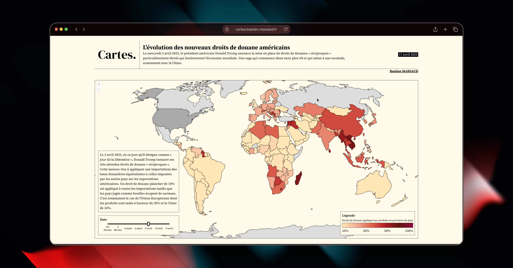

# Cartes

🗺️ A curated collection of interactive maps crafted by me, Bastien!

Available on https://cartes.bastien-marsaud.fr

## Maps
* 22/01/2026 - [Le genre des cours d'eau](https://cartes.bastien-marsaud.fr/cartes/genre-des-cours-deau/)
* 18/11/2025 - [Mes coups aux échecs](https://cartes.bastien-marsaud.fr/cartes/mes-coups-aux-echecs/)
* 19/06/2025 - [Mroc Bike & Climb 2025](https://cartes.bastien-marsaud.fr/cartes/mroc-bike-and-climb-2025)
* 22/05/2025 - [La couleur des boîtes aux lettres](https://cartes.bastien-marsaud.fr/cartes/couleurs-boites-aux-lettres/)
* 14/05/2025 - [Balade à vélo le long de la Via Rhôna](https://cartes.bastien-marsaud.fr/cartes/via-rhona-mai-2025/)
* 30/04/2025 - [Les intentions d'embauche en 2025](https://cartes.bastien-marsaud.fr/cartes/intentions-embauche-2025/)
* 23/04/2025 - [Rétrospectives des inondations en Europe de l'année 2024](https://cartes.bastien-marsaud.fr/cartes/retrospective-inondations-2024/)
* 17/04/2025 - [L'évolution des nouveaux droits de douane américains](https://cartes.bastien-marsaud.fr/cartes/usa-tariffs-2025/)
